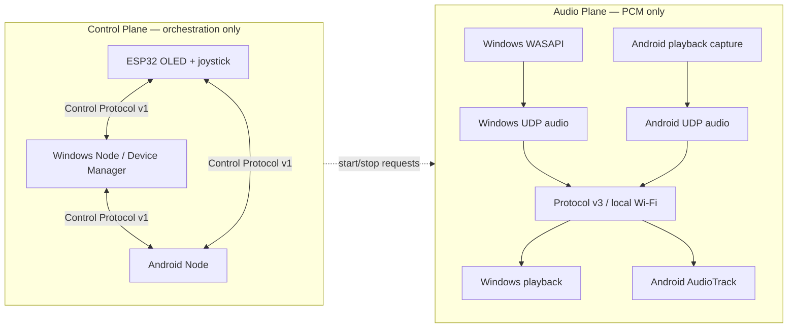

# AudioStreamer


AudioStreamer is an educational, low-latency PCM transport project. Windows and Android nodes can capture eligible system playback, send raw PCM over local UDP, receive PCM, and play it. A separate Control Plane discovers nodes and requests stream lifecycle changes. An ESP32 provides a hardware Control Plane interface and never transports audio.

> This repository is under active development. Builds and protocol documentation do not imply that every device combination has passed physical network or listening tests.

## Features

- Windows mixed-output capture through WASAPI loopback.
- Android mixed playback capture where Android version, user consent, and source-app policy permit it.
- Protocol v3 PCM packetization and best-effort UDP transport.
- Independent send and receive lanes with bounded playback buffering.
- Windows and Android node lifecycles, plus a standalone Windows Device Manager.
- Control Protocol v1 discovery, heartbeats, peer registry, and stream start/stop requests.
- ESP32 DevKit V1 controller with SSD1306 OLED, KY-023 joystick, dynamic peer menus, and Control Protocol v1 commands.

## Architecture



Audio Protocol v3 and Control Protocol v1 are separate wire protocols. Control messages do not contain PCM. The ESP32 controller advertises no audio capabilities. See [ARCHITECTURE.md](ARCHITECTURE.md), [PROTOCOL.md](PROTOCOL.md), and [CONTROL_PROTOCOL.md](CONTROL_PROTOCOL.md).

## Project structure

```text
audio_plane/                 Shared PCM models, protocol v3, transport, buffering
core/                        Platform-neutral node contracts and events
control_plane/               Python Control Protocol v1 and Windows UDP broker
control_client/              Standalone Windows Control Plane UI
platforms/windows/           Windows capture, playback, node, and desktop UI
platforms/android/           Android node and platform adapters
esp32_controller/            ESP32 Control Plane hardware controller
config/                      Windows local configuration
docs/                        Node architecture and supporting docs
```

See [PROJECT_STRUCTURE.md](PROJECT_STRUCTURE.md) for the detailed folder guide.

## Screenshots

Screenshots are not included in this source snapshot. Add current Windows, Android, and ESP32 captures here when release assets are prepared; do not use mockups as evidence of runtime validation.

## Requirements

- Windows: 64-bit Windows, Python 3.13 with Tkinter; first launch needs internet access to install pinned PyAudioWPatch.
- Android: Android 7/API 24+ for receive/playback; Android 10/API 29+ for playback capture and sending. Building requires Android SDK 37 and a JDK compatible with the configured Gradle toolchain.
- ESP32: ESP32 DevKit V1 (ESP-WROOM-32), PlatformIO Core or IDE, SSD1306 I²C OLED, KY-023 joystick.
- Cross-device operation requires local UDP reachability. Firewall rules, VPNs, and Wi-Fi client isolation can prevent discovery or audio delivery.

## Quick start — Windows

1. Install Python 3.13 x64 with Tkinter.
2. Run `AudioStreamer.bat` from the repository root. It creates `.venv`, installs `platforms/windows/requirements.txt`, and opens the node UI.
3. Build/install the Android app or flash the ESP32 controller as described in [BUILDING.md](BUILDING.md).
4. Ensure all devices use the same Control Plane UDP port (default `55050`) and are on a reachable local network.

The standalone desktop control application starts with `AudioStreamerDeviceManager.bat`. See [DEVICE_MANAGER.md](DEVICE_MANAGER.md) for its controls and limitations.

## Building and running

Platform build steps, tool versions, APK output, PlatformIO commands, and validation limits are in [BUILDING.md](BUILDING.md). Windows launchers are provided at the repository root. Android is built with the checked-in Gradle wrapper. ESP32 is built and flashed with PlatformIO.

## ESP32 Controller

The ESP32 is a Control Plane client with a live node list and joystick-driven sender/receiver selection. It sends existing Control Protocol v1 START/STOP messages; its UI can report that a command was queued but cannot confirm audible playback. It contains no audio capture, playback, or PCM networking. Wi-Fi credentials belong in the ignored `esp32_controller/include/audiostreamer/config/WifiSettings.h`; follow [esp32_controller/README.md](esp32_controller/README.md).

## Current status and known limitations

- Audio Protocol v3 is the current PCM wire format. It is not wire-compatible with retired v2 packets; update sender and receiver together.
- Audio UDP is best effort: no acknowledgements, retransmissions, encryption, compression, or clock synchronization are implemented.
- Android playback capture is unavailable below API 29 and may be blocked by source-app capture policy or protected content. Capture requires user consent.
- Control Protocol v1 is IPv4 and unauthenticated on the LAN. Use it only on a trusted network.
- Multiple-receiver control requests do not provide PCM fan-out; each sender has one configured audio destination.
- Physical LAN, long-duration, simultaneous-lane, and acoustic quality validation remains required across target hardware.

## Roadmap

- Complete repeatable Windows ↔ Android ↔ ESP32 LAN interoperability and long-duration validation.
- Prepare signed Android release packaging and screenshots after release testing.
- Consider PCM fan-out and transport resilience only as separately scoped future work; wire formats remain unchanged in this repository cleanup.

## Development and contributions

Read [DEVELOPMENT.md](DEVELOPMENT.md) before changing protocol, platform boundaries, or Control Plane responsibilities. Contributions should include relevant build/validation results and distinguish host compilation from hardware/network verification. CI is not configured yet.

## License

No `LICENSE` file is present, and a license has not been selected. The repository is **not yet ready for public redistribution** until the project owner chooses and adds an appropriate license. Third-party library licenses remain those of their respective projects.

## Credits

AudioStreamer uses PyAudioWPatch/PortAudio for Windows audio I/O, Kotlin and Android platform audio/network APIs, PlatformIO with the Arduino ESP32 framework, Adafruit SSD1306 and Adafruit GFX, and Python's standard library. See platform dependency manifests and upstream projects for their license notices.
