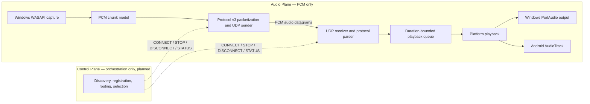

# AudioStreamer

AudioStreamer is a learning project for low-latency PCM transport between networked devices. Windows and Android can independently send protocol v3 PCM and receive/play protocol v3 streams. Windows captures the system mix with WASAPI loopback; Android uses its playback-capture API where the OS and source app permit it.

The repository separates the **Audio Plane** from the future **Control Plane** and places a platform-neutral node contract above platform implementations. Audio moves only through the Audio Plane. Device discovery, registration, and routing belong to a separate Control Plane and are not implemented. Current endpoint selection is static configuration; there are no permanent server/client concepts in the intended architecture, only node capabilities and runtime roles.

## Current implementation

| Capability | Status |
| --- | --- |
| Windows WASAPI loopback capture | Implemented with PyAudioWPatch |
| PCM model and protocol v3 serialization | Implemented; `PROTOCOL.md` is normative |
| Windows UDP sending and receiving | Implemented as independent node capabilities |
| Windows playback | Implemented through PyAudioWPatch/PortAudio |
| Android UDP send, receive, protocol v3, bounded buffering, `AudioTrack` playback | Implemented for stereo float32 |
| Android mixed playback capture | Implemented on Android 10+ with user consent and source-app policy restrictions |
| Control Plane discovery and routing | Not implemented |
| Multiple destinations, compression, encryption | Not implemented |

Protocol v3 is the wire format currently used by both implementations. This refactor preserves the packet layout and stream behavior. Its v3 format is not wire-compatible with the retired v2 layout; update the Windows sender and Android receiver together.

## Architecture



The dashed control path carries commands/status only. The Control Plane never carries PCM, and Audio Plane modules must not depend on discovery, UI, routing, or hardware controllers. See [ARCHITECTURE.md](ARCHITECTURE.md) for plane boundaries and [docs/NODE_ARCHITECTURE.md](docs/NODE_ARCHITECTURE.md) for node contracts, lifecycle, and Windows composition.

## Requirements

### Windows node

- 64-bit Windows with capture and playback endpoints.
- Python 3.13 and Tkinter.
- Internet access for first-run installation of the pinned `PyAudioWPatch` dependency.

### Android node

- Android 7.0 (API 24) or newer for receiving and playback. Android 10 (API 29) or newer for mixed playback capture and sending.
- Android Studio to build from source, or install the debug APK generated by Gradle.
- Windows and Android devices on the same reachable local network. Access-point client isolation can block UDP.
- Sender requires the `RECORD_AUDIO` permission and a per-session user-approved MediaProjection capture prompt. Android 14/API 34+ also requires the declared media-projection foreground service permission. The app requests a foreground service notification while capture is active.
- Because the app targets Android 17/API 37, local UDP send and receive require the runtime `ACCESS_LOCAL_NETWORK` permission. Earlier Android versions grant this access through `INTERNET`.

## Run the system

1. On Windows, run `AudioStreamer.bat`. It creates `.venv`, installs `platforms/windows/requirements.txt` on first launch, and opens the node controls.
2. Choose a destination IP/port and a local receive port, then save configuration if you want settings restored on the next launch.
3. Start **Sender** and **Receiver** independently. Either can run alone or both can run simultaneously.
4. For Windows-to-Android, set the Windows destination to the phone's local IP and Android receive port (default `5005`), then start both node lanes as needed.
5. For Android-to-Windows, set Android's destination to the Windows local IP and receive port, grant local-network access and capture consent, then start the Android sender.
6. For Android-to-Android, configure each node's destination and receive port to point to its peer. A node may send and receive simultaneously.

UDP is connectionless. A Windows packet-sent count confirms only that the local socket accepted the datagram; it does not confirm phone receipt or playback. Stop the Windows stream before closing the receiver for a clean shutdown.

## Configuration and diagnostics

The Windows app loads and creates [`config/config.toml`](config/config.toml). Its GUI saves the node name, destination address/port, receive port, and capture settings. `audio_device_index = -1` means the default device and is reserved for future selection; current capture and playback use the default endpoints. Capture rate and channels follow the Windows endpoint mix format. The existing TOML keys `receiver_ip` and `receiver_port` remain as persisted names for the outbound peer destination. Android saves its node name, destination IP/port, receive port, and log level in app-private `SharedPreferences`.

Rotating Windows logs are written to `logs/audiostreamer.log`; Android lifecycle, capture, UDP, invalid-packet, queue-overflow, and playback diagnostics are available in Logcat. The receive path reports valid/invalid datagrams, sequence gaps, queue overflow, playback errors, and byte/packet totals. The software playback queue targets 80 ms of PCM with a hard packet-count ceiling. Protocol v3 has no synchronized sender timestamp, so one-way latency is unavailable.

## Build Android

Open [`platforms/android`](platforms/android) in Android Studio, or from that directory run `gradlew.bat :app:assembleDebug`. The APK is written to `platforms/android/app/build/outputs/apk/debug/app-debug.apk`. The application ID remains `com.audiostreamer.receiver` to preserve Android's install identity across the source reorganization. This is a debug build, not a signed public-store release.

## Repository layout

```text
audio_plane/                 Shared PCM types, protocol v3, UDP transport
core/                        Platform-neutral node state, events, and audio contracts
control_plane/               Reserved architectural boundary; no implementation yet
platforms/windows/           WASAPI capture, PortAudio playback, desktop node/composition/UI
platforms/android/           Android node application and platform adapters
config/                      Windows user configuration
logs/                         Runtime logs (generated)
main.py                       Windows desktop entry point
AudioStreamer.bat             Windows setup and launcher
README.md                     Project overview and getting started
ARCHITECTURE.md               Plane boundaries and module responsibilities
docs/NODE_ARCHITECTURE.md     Node interfaces, lifecycle, and dependency injection
PROTOCOL.md                   Normative v3 wire specification
DEVELOPMENT.md                Contributor workflow and coding principles
CHANGELOG.md                  Project evolution
```

## Troubleshooting

| Symptom | Check |
| --- | --- |
| Android stays at “Waiting for server...” | Start the peer sender; check receive port, local-network permission on API 37+, Windows Firewall, VPN, and Wi-Fi client isolation. |
| Android sender receives silence | Confirm Android 10+, accept both permission prompts, and use an app whose playback usage and capture policy allow capture. Some apps and protected media deliberately block capture. |
| Android sender fails before capture | Check `RECORD_AUDIO`, MediaProjection consent, Android 14+ foreground-service permission/notification, and Logcat. |
| Sender count rises but Android receives nothing | UDP has no acknowledgement. Verify the destination address and local network reachability. |
| Windows receiver stays at “Waiting for audio” | Check the peer's destination IP and port against this node's receive port, Windows Firewall, and Wi-Fi client isolation. |
| Windows receives packets but playback fails | Check the default Windows output device and `logs/audiostreamer.log` for PortAudio errors. |
| Android reports invalid packets | Ensure both apps use protocol v3; consult [PROTOCOL.md](PROTOCOL.md). |
| Packets arrive but there is no sound | Check phone media volume and Windows default output, then stop and restart both endpoints. |
| Audio has gaps | Reduce competing Wi-Fi traffic. Smaller capture buffers can lower latency but increase scheduling sensitivity. |
| Windows launcher fails | Install Python 3.13 with Tkinter and allow first-run dependency installation. Review `logs/audiostreamer.log`. |

## Roadmap

The next work should complete device-level and long-duration validation, then add Control Plane capabilities as a separate system that issues commands without carrying audio. Multiple receivers, ESP32 control, compression, encryption, and discovery remain future work.
