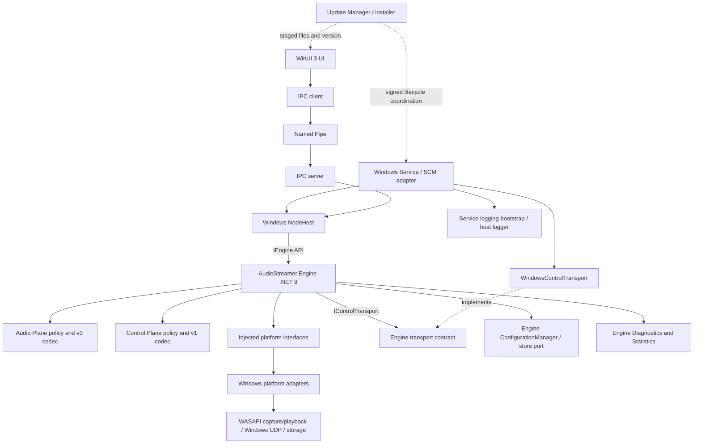
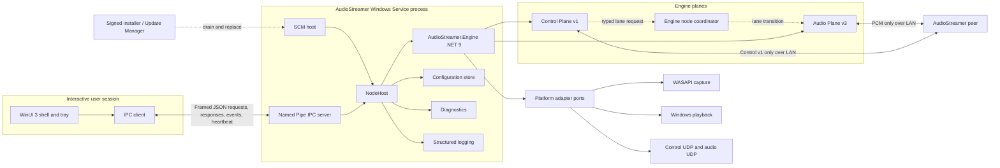
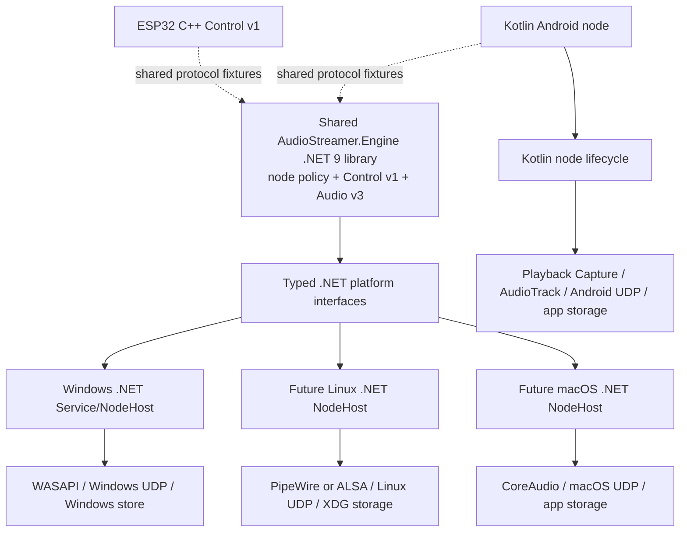
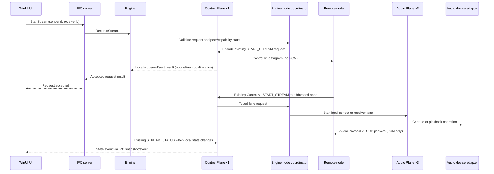

# AudioStreamer v2 Architecture Blueprint

**Status:** Architecture frozen for implementation planning. Implementation must honor [Architecture Rules](ARCHITECTURE_RULES.md) and complete the readiness gates in [Architecture Audit](ARCHITECTURE_AUDIT.md) and [Test Plan](TEST_PLAN.md).
**Scope:** Windows service, WinUI 3 client, shared portable Engine, platform adapters, IPC, diagnostics, configuration, logging, packaging, and update boundary.
**Compatibility:** Audio Protocol v3 and Control Protocol v1 remain unchanged.

This is the system overview. Detailed subsystem contracts live in [Engine Architecture](ENGINE_ARCHITECTURE.md), [Architecture Rules](ARCHITECTURE_RULES.md), [Windows Service](WINDOWS_SERVICE.md), [IPC Protocol](IPC_PROTOCOL.md), [UI Specification](UI_SPECIFICATION.md), [Installer and Updates](INSTALLER_AND_UPDATES.md), [Test Plan](TEST_PLAN.md), [Repository Structure v2](REPOSITORY_STRUCTURE_V2.md), [Coding Standards](CODING_STANDARDS.md), and [Architecture Audit](ARCHITECTURE_AUDIT.md). These are frozen target specifications, not descriptions of shipped functionality.

## 1. Purpose and design decisions

AudioStreamer v2 separates the lifetime of the node from the lifetime of its user interface. Windows Service owns a `NodeHost`; `NodeHost` composes and runs the portable `Engine`; platform adapters provide operating-system capabilities. WinUI is a named-pipe client. No PCM audio crosses IPC.

Windows v2 uses a **C#/.NET 9 Engine class library** with no WinUI or Windows Service dependency. It owns Windows node business logic and protocol models/codecs; Windows platform adapters implement WASAPI, playback, and networking interfaces. Keep Engine core APIs and policies OS-neutral so .NET hosts on future Linux/macOS can reuse them. Android remains its existing native Kotlin implementation and ESP32 remains C++; both preserve compatibility through normative protocol documents and shared byte fixtures. No Rust, MAUI, Electron, or Flutter is part of this architecture. Python remains a v1 reference during migration and is not shipped in the v2 product.

This is a substantial Windows port. Reuse the protocol specifications and behavior, while porting the Windows implementation to C#/.NET 9 and validating it against byte-level fixtures and cross-platform interoperability checks. Do not change protocol documents or packet bytes as part of that port. The stable v2 installer does not ship Python; migration tooling may use the development Python but must not make the product depend on it.

**Gate before implementation:** prove WASAPI loopback, endpoint selection, and output playback from the intended Windows service account and Session 0 across logon/logoff and remote-session conditions. Microsoft documents loopback capture from Session 0 across user sessions, while services cannot interact directly with the desktop; neither fact proves that this project’s specific adapters and endpoint choices will work in the installed product. [Loopback recording](https://learn.microsoft.com/en-us/windows/win32/coreaudio/loopback-recording) · [Windows service interaction](https://learn.microsoft.com/en-us/windows/desktop/Services/interactive-services).

### Decisions recorded here

1. Windows UI is WinUI 3/.NET; Windows Service is a .NET SCM host.
2. A reusable .NET 9 Engine class library contains Windows node business logic and has no UI or SCM references. Windows platform APIs remain in adapters.
3. Windows UI/service IPC uses **JSON over a local named pipe**, with explicit length framing and a versioned envelope. MessagePack is not used for this low-rate control channel.
4. The Audio Plane and Control Plane stay separate inside the Engine and on the network. Control Protocol v1 never carries PCM.
5. Audio buffers, UDP datagrams, and capture callbacks stay inside the Engine/platform-adapter process. IPC carries commands, snapshots, events, and bounded diagnostics only.
6. The Windows Service is the single source of truth and owns a continuously running Engine/NodeHost. Closing, quitting, crashing, or restarting the UI only disconnects the IPC client; it never sends `StopNode` and never changes discovery, Control Plane, or audio state. Explicit user actions such as Stop Stream remain separate commands.
7. Updates are installed by a signed installer/update coordinator, not by the running Engine replacing its own binaries.

## 2. Component ownership

| Component | Owns | Must not own |
|---|---|---|
| **Windows Service** | SCM integration, process lifetime, service account, recovery reporting, creation/disposal of `NodeHost`, IPC server lifetime, configuration/logging bootstrap, process-level health | Runtime node configuration policy, protocol policy, audio buffers, installer/update transactions |
| **NodeHost** | One local node composition; Engine instance; platform-adapter set; startup ordering; dependency injection; orderly start/stop and restart | WinUI, SCM implementation details, wire-format definitions, per-user UI preferences |
| **Engine** | Node lifecycle/use cases; Audio and Control Planes; discovery/peer registry; capture/playback/stream coordination; statistics, diagnostics, runtime configuration, internal events, immutable snapshots, and protocol v1/v3 codecs | WinUI, SCM APIs, concrete Windows audio/network APIs, UI state, pipe framing, installer APIs |
| **Platform Adapters** | WASAPI capture, Windows playback, audio-device enumeration, UDP socket operations, monotonic clock, durable settings/identity storage, OS-specific permission/device behavior | Control/audio protocol definitions, peer policy, stream-routing decisions, UI behavior |
| **Audio Plane** | PCM capture-to-packet and packet-to-playback workflows; v3 serialization/parsing; bounded buffering and sequence/statistics policy | Discovery, node registry, START/STOP control, UI state |
| **Control Plane** | v1 datagram codec; HELLO/HEARTBEAT/GOODBYE exchange; discovery observations; command dispatch and status reporting | PCM, Audio Plane packet parsing, audio device access, duplicate peer state |
| **Windows Control transport adapter** | `UdpClient`, configured socket binding, bounded asynchronous send/receive loops, network-change notifications, and transport faults behind Engine `IControlTransport` | Control v1 codec, discovery/heartbeat/expiry policy, route decisions, peer registry |
| **IPC Layer** | Authenticated local client connections; framing; schema/version validation; command dispatch to NodeHost; event fan-out; per-client backpressure | UDP, PCM, audio device operations, duplicated Control Protocol semantics |
| **Diagnostics** | Engine-owned bounded node/plane diagnostics and health projection; Service contributes process/SCM health through an injected host-health port | Mutating node state, parsing log files as a data API, unbounded metric histories |
| **Configuration** | Engine-owned canonical runtime settings, validation, update policy, and immutable snapshots; platform storage adapter loads/migrates/persists them; Service bootstraps storage paths and initial values | UI preference persistence, protocol serialization, direct UI control |
| **Logging** | Structured operational records, rotation/retention, redaction, correlation IDs | Live status API, audio callback work, unbounded or sensitive payload dumps |
| **Update Manager** | Signed version metadata and artifact validation; coordinate drain, install, rollback, restart, version reporting | Runtime audio/control networking, modifying packets, live in-place replacement by the service itself |
| **WinUI Application** | Navigation, view models, user input, tray commands, IPC client, rendering snapshots/events | UDP sockets, discovery, registry, capture/playback, protocol codecs, authoritative state |

### Platform-agnostic Engine contract

The Engine is a .NET 9 class library with no WinUI, SCM, or Windows-only references in its core assembly. It takes injected capabilities through narrow interfaces and publishes typed snapshots/events. A separate Windows adapter assembly may use WASAPI and Windows networking APIs. Android remains Kotlin and does not link the Windows Engine in v2; Linux/macOS .NET hosts can reuse the platform-neutral library when those platforms are implemented.

The native adapter layer supplies:

- `AudioCapture`: enumerate/select/start/read/stop capture, returning bounded PCM frames with format metadata.
- `AudioPlayback`: enumerate/select/start/write/flush/stop playback.
- `DatagramTransport`: bind/send/receive/close for the configured Control Plane and Audio Plane UDP endpoints. Each protocol remains separately configured and separately owned.
- `Clock`: monotonic timestamps for heartbeat expiry, statistics, and scheduling.
- `NodeStore`: persist identity and validated settings through OS-appropriate storage; called only by Engine ConfigurationManager.
- `DeviceCatalog`: report selectable capture/render endpoints and availability changes.
- `DiagnosticsSink`: publish counters and health transitions without synchronous logging from real-time callbacks.

For Control v1, the Engine owns `ControlCoordinator` policy and state. It depends only on `IControlTransport`, whose endpoint/event contracts contain no socket or Windows types. `WindowsControlTransport` implements that port and owns all Windows UDP socket and network-change resources. The Service registers both implementations and starts/stops the Engine; it does not run a separate Control runtime.

Adapters transfer ownership explicitly. Capture callbacks provide borrowed or pooled frames; the Engine must not retain callback-owned memory past its lifetime. Queue capacity and drop policy are explicit. Use typed .NET interfaces and immutable records across Engine boundaries; avoid raw `object` payloads and mutable shared collections. Engine and IPC schema versions are reported independently during handshake.

## 3. Dependency direction



The dependency rule is inward: UI and OS adapters depend on the service/Engine contracts; the Engine does not depend on UI, Windows Service, IPC, or concrete adapters. Audio Plane and Control Plane share node identity/configuration contracts but do not call each other’s protocol code.

## 4. Subsystem interfaces

### NodeHost ↔ Engine

The Engine exposes only the frozen `IEngine` public API documented in [Engine Architecture](ENGINE_ARCHITECTURE.md#4-public-engine-and-adapter-interfaces). NodeHost lifecycle calls and Named Pipe request dispatch both use that API. No Service/IPC code calls individual managers.

Commands are typed domain operations such as `StartSender`, `StopSender`, `StartReceiver`, `StopReceiver`, `RequestStream`, `StopStream`, `UpdateSettings`, `RestartDiscovery`, and `SetPaused`. Windows Service lifetime remains outside the Engine API. A command response means accepted/rejected locally; it must not claim UDP delivery or audible playback unless a later state/status event proves that state. Engine instance lifetime is managed only by the Service host scope.

### Engine ↔ Platform Adapters

The Engine requests capabilities by interface and receives asynchronous completions/events. A missing capability is reported as unsupported at startup/device-selection time. Platform-only settings are carried in a namespaced adapter settings object and are not added to protocol fields. Network adapters do not decide peer policy; the Control Plane supplies destination endpoints and messages.

### WinUI ↔ IPC

The UI sends a request envelope with a unique request ID. The server responds with a correlated result and independently pushes event envelopes. On connection, the UI sends `Hello`; the service returns supported IPC schema versions, Engine/service/UI compatibility versions, current service and NodeHost states, and a full snapshot. The UI then applies events. On reconnect it requests a fresh snapshot and discards events from the previous connection epoch.

Initial operations: `GetSnapshot`, `GetStatus`, `GetPeers`, `GetStreams`, `GetSettings`, `GetStatistics`, `StartNode`, `StopNode`, `StartStream`, `StopStream`, `Pause`, `Resume`, `UpdateSettings`, `GetAudioDevices`, `SelectAudioDevices`, `RestartDiscovery`, `GetDiagnostics`, `GetLogsPage`, `GetVersions`, and `BeginUpdateCheck` (future). Engine operations map to `IEngine`; service-only status/log/update operations use explicit host services. Operations are allow-listed; the pipe is not a generic RPC or shell interface. `ShutdownService` is not exposed to ordinary UI clients under the default policy.

## 5. Named Pipe encoding: JSON vs MessagePack

| Concern | JSON | MessagePack |
|---|---|---|
| Human inspection/debugging | Directly readable in pipe traces and support captures | Requires a decoder/tooling |
| .NET and Kotlin support | Mature and straightforward; System.Text.Json is available across .NET hosts | Mature, compact serializers are available, but both ends need matching schema conventions |
| Size/speed | Larger and more parsing/allocation cost | Smaller and faster in many cases |
| Schema evolution | Explicit field names; additive optional fields are easy to inspect | Compact map keys or positional arrays need disciplined schema/version handling |
| Workload fit | Low-rate commands, state snapshots, and diagnostics | High-rate or bandwidth-constrained structured data |

**Recommendation: JSON.** This pipe carries low-rate control and event data on one machine; audio never crosses it. Its payload volume is not the bottleneck, while readable diagnostics and easy cross-language compatibility reduce implementation and support cost. JSON is not used as a substitute for the binary audio/control network protocols. If IPC performance later proves material, profile first and introduce a separately versioned encoding negotiation rather than silently changing framing.

### Framing and envelope

- One message is `u32 little-endian payload_length` followed by exactly that many UTF-8 JSON bytes.
- Maximum message: 1 MiB; reject zero length, over-limit frames, invalid UTF-8, malformed JSON, unknown required envelope fields, and unsupported schema versions.
- Envelope fields: `schemaVersion`, `kind` (`request`, `response`, `event`), `messageType`, `requestId` (when correlated), `connectionEpoch`, and `payload`.
- The stream is ordered per pipe connection. A response is sent for each request. Events may be coalesced for replaceable snapshots/metrics; lifecycle and error events are not silently dropped.
- Per-client outbound queues are bounded. A slow UI receives a `ResyncRequired` event or is disconnected; audio/control workers never wait for UI writes.
- Avoid logging full payloads by default. Log type, request ID, duration, result code, and sizes.

### Pipe security

Use a local-only pipe with a restrictive Windows DACL for the service SID and intended interactive users. Validate the connecting user token and authorize each operation by role. The service runs with least privilege; it does not accept arbitrary file paths, process launches, or network destinations from untrusted IPC input. Do not rely on a static shared key embedded in the client. Apply message size/rate limits, strict DTO validation, and a connection limit. Administrative service/update operations require a separate privileged pathway.

## 6. State machines and lifecycle

### Windows Service

```text
Stopped -> StartPending -> Running -> StopPending -> Stopped
                 |          |
                 +-> Failed <-+
```

`StartPending` initializes logging/configuration, creates `NodeHost`, and reports checkpoints while initialization proceeds. `Running` owns the pipe server and NodeHost supervisor. A fatal host failure is logged and reported to SCM; configured recovery actions restart the service with bounded retry delays. `StopPending` rejects new mutating requests, asks NodeHost to drain, waits only to a documented deadline, then closes IPC and disposes resources. Repeated stop is idempotent.

### NodeHost

```text
Created -> LoadingConfiguration -> InitializingAdapters -> StartingEngine
        -> Running -> Stopping -> Stopped
                       |             ^
                       +-> Degraded -+
                       +-> Faulted -> Recovering -> InitializingAdapters
```

`Running` can be healthy or degraded. A capture device disappearing may degrade the sender while the receiver remains operational; a Control Plane socket failure must not corrupt the Audio Plane state. Recovery is bounded, observable, and does not reset persistent Node ID. NodeHost stop is graceful and distinct from SCM process stop.

### Engine node and lanes

Node aggregate: `Stopped → Starting → Idle ↔ Active → Stopping → Stopped`; unrecoverable initialization errors enter `Faulted`. `Active` means one or more lanes are active, not that a peer has confirmed audible playback.

Sender and receiver lanes transition independently:

```text
Stopped -> Starting -> Running -> Stopping -> Stopped
              |          |                     ^
              +-> Failed +-> Degraded ----------+
```

Each lane has its own resource scope and cancellation token. Stopping the sender does not stop receiver playback. Control discovery has a separate state: `Disabled → Starting → Discovering ↔ Degraded → Stopping → Disabled`. Peer records expire from monotonic last-seen time.

### IPC client and UI

```text
Disconnected -> Connecting -> Synchronizing -> Connected -> Reconnecting
                                              |                 |
                                              +-> Closing <-----+
```

The Service process is the machine-level source of truth; its hosted Engine owns canonical runtime settings, peers, statistics, diagnostics, and lifecycle state. The UI reaches Engine state only through Named Pipe IPC mapped to `IEngine`. The UI may cache a read-only snapshot for rendering, but discards/resynchronizes that cache after reconnect. A lost pipe does not stop the node. Closing the main window hides the UI to tray; Quit disconnects and exits without issuing any node command. UI crash/restart has the same effect as disconnect only. An explicit Stop Node/Stop Stream action is separate and requires a deliberate user command.

### Update Manager

`Idle → Checking → Available → Downloading → Verifying → Staged → Draining → Installing → Restarting → Healthy`. Any verification/install/health failure transitions to `RollingBack → Healthy` or `FailedNeedsRepair`. Only signed manifests and signed binaries are accepted. Service and UI report versions on pipe handshake; incompatible protocol schema versions fail closed with a user-readable update-required result.

## 7. Component diagrams

### Windows process and subsystem view



### Portable Engine and platform implementations



Platform adapters own API mechanics only. Audio format conversion, if ever needed, is an explicit adapter capability and must not silently alter v3’s stereo float32 packet contract.

## 8. Sequence diagrams

### Windows startup and UI attach

```mermaid
sequenceDiagram
  participant SCM as Windows SCM
  participant S as AudioStreamer Service
  participant B as Configuration bootstrap
  participant C as Engine ConfigurationManager / store
  participant L as Logging bootstrap
  participant D as Dependency Injection
  participant H as NodeHost
  participant E as Engine
  participant A as Platform adapters
  participant UI as WinUI UI
  participant P as Named Pipe
  SCM->>S: Start service (automatic)
  S->>B: Resolve storage/log paths and legacy migration source
  B-->>S: Bootstrap snapshot
  S->>L: Initialize logger and process-health fallback
  S->>D: Register Service, Engine managers, drivers, IPC
  D->>H: Create NodeHost and Engine scope
  H->>E: Compose Engine with ports/options
  E-->>H: Engine handle
  E->>C: Load/migrate/validate settings and stable Node ID
  C-->>E: Immutable Engine settings snapshot
  H->>A: Initialize required capabilities
  A-->>H: Capability and device availability
  H->>E: Start
  E->>A: Start Control Plane UDP and discovery
  E-->>H: Starting/Idle snapshots and events
  S->>P: Start local IPC server
  UI->>P: Connect and Hello(schema, UI version)
  P-->>UI: Accepted + service/engine versions
  UI->>P: Subscribe
  P-->>UI: Start bounded event buffering
  UI->>P: GetSnapshot
  P->>H: Get current node/peer/diagnostic snapshot
  H-->>P: Immutable snapshot
  P-->>UI: Snapshot + connection epoch + event watermark
  UI->>UI: Apply snapshot; discard queued events ≤ watermark
  E-->>P: Subsequent state/peer/statistics events
  P-->>UI: Bounded asynchronous event stream
```

### Orderly shutdown

```mermaid
sequenceDiagram
  participant UI as Tray UI
  participant P as IPC server
  participant H as NodeHost
  participant E as Engine
  participant CP as Control Plane
  participant A as Audio adapters
  UI->>P: Disconnect (window close, Quit, crash, or restart)
  P-->>UI: Pipe closes; no node command is sent
  Note over H,E: Engine, discovery, Control Plane, lanes, sockets, and timers continue unchanged.
  Note over UI,P: Relaunch reconnects, negotiates versions, subscribes, and requests a fresh snapshot.
```

When Windows or an administrator stops the service for maintenance, the SCM stop path drains NodeHost and Engine before process exit. UI disconnect is never a service-stop path. If service shutdown times out, the service reports outstanding resource owners and does not claim a clean stop.

### Stream start and PCM flow



The actual control message flow remains whatever Control Protocol v1 already defines. IPC is only local orchestration. A successful local request or UDP send is not presented as proof that the remote node accepted it or that audio is audible.

## 9. Diagnostics, logging, and configuration

### Diagnostics

Diagnostics is a read-only projection of bounded counters and current state. It reports service/Engine versions, uptime, Control Plane state, peer count, sender/receiver state, selected device IDs, packets/bytes sent and received, invalid/dropped packets, queue depth/duration, capture drops, last error code, and adapter availability. CPU and memory may be sampled by the host at a modest interval. Latency is reported only when it is actually measurable; Audio Protocol v3 has no sender timestamp, so one-way LAN latency must be “unavailable” unless measured through an explicitly defined local method.

Stats are aggregated at a bounded cadence (suggested 1 Hz) and coalesced for IPC. Audio callbacks never allocate diagnostic strings, serialize JSON, write logs, or block on clients.

### Logging

Use structured logs with timestamp, severity, component, event name, process/service instance ID, Node ID, and request/stream correlation ID where available. Write to a machine-wide application log directory with rotation and a documented retention cap. Never log PCM, credentials, pipe payload bodies, or unredacted private paths. Rate-limit repeated socket/device errors. User-facing diagnostics are derived from typed state/error records, not scraped from logs.

### Configuration

Configuration is loaded before Engine startup, validated as a complete snapshot, and atomically replaced on save. Persistent Node ID is machine-stable and nonzero. Separate machine settings (ports, node identity, service behavior) from per-user UI preferences (theme, navigation, tray behavior). Audio endpoint selection uses stable endpoint identifiers, not enumeration indexes. Port values are sourced from configuration; no port is duplicated as a magic literal across components. Migration is versioned and preserves existing TOML settings where possible.

Engine ConfigurationManager is the canonical runtime configuration writer, persisting atomically through the injected Windows storage adapter. The Service bootstraps configuration location and migration before Engine startup. UI changes pass through `IEngine.UpdateSettingsAsync` and are returned as an applied snapshot or field-level validation errors. Secret material, if introduced later, belongs in Windows-protected storage and never in the IPC log.

## 10. Update Manager and installer boundary

The installer owns first install, service registration, startup/recovery policy, runtime prerequisites, shortcuts, and uninstall. A future Update Manager verifies signed metadata and package signatures before asking NodeHost to stop. It stages the full UI/service/Engine set, then invokes the installer/coordinator to replace binaries and restart. The service does not overwrite loaded DLLs or its own executable.

The install layout separates immutable binaries from mutable data:

```text
Program Files/AudioStreamer/       signed UI, service, Engine, adapter binaries
ProgramData/AudioStreamer/         machine config, Node ID, logs, staged update metadata
User AppData/AudioStreamer/        UI preferences and user-scoped diagnostics exports
```

Use an MSI/bootstrapper approach capable of installing a Windows Service and the unpackaged WinUI application together. Exact tool choice and signing identity are release decisions. Install/upgrade rollback must restore a compatible service/UI/Engine set. Version handshake rejects incompatible IPC or Service/Engine assembly combinations and gives a repair/update action.

## 11. Recommended repository structure

```text
src/
  AudioStreamer.Engine/             .NET 9 business logic, Control v1, Audio v3
  AudioStreamer.Service/            .NET Windows Service, NodeHost, IPC server
  AudioStreamer.UI/                 WinUI 3 client, MVVM, navigation, tray
  AudioStreamer.Contracts/          Versioned Named Pipe DTOs only; Engine API types stay in Engine
  AudioStreamer.Common/             Small cross-cutting primitives only
  AudioStreamer.Platform.Windows/   WASAPI, playback, UDP, config/log/diagnostics adapters
installer/                          MSI/bootstrapper and prerequisite/update authoring
tests/
  AudioStreamer.Engine.Tests/
  AudioStreamer.Service.Tests/
  AudioStreamer.IPC.Tests/
  AudioStreamer.UI.Tests/
  AudioStreamer.ProtocolFixtures/
tools/                               Build, package, signing and diagnostics tools
platforms/android/                   Existing Kotlin node; wire compatibility retained
esp32_controller/                    Existing C++ control-only firmware
config/                              v1 migration examples/fixtures, not runtime config
docs/                                Normative protocols and architecture specifications
```

During migration, retain the current Python implementation under its existing paths as a v1 reference and interoperability oracle. Do not run both engines as simultaneous Windows nodes; duplicate Node IDs or UDP port ownership would cause conflicts. Remove or clearly mark development launch scripts only after installer-based startup and rollback have been validated.

## 12. Migration gates and validation criteria

1. **Architecture spike:** service-account audio capture/playback, stable device enumeration, service auto-start, and restart behavior on supported Windows versions.
2. **Engine parity:** .NET serializers/parsers pass canonical v1/v3 byte fixtures; reject malformed packets per normative docs; match Python/Kotlin/ESP32 behavior for existing messages.
3. **Adapter behavior:** bounded buffers, explicit ownership, shutdown deadlines, independent audio lanes, device removal/recovery, and no real-time logging/JSON work.
4. **IPC security and correctness:** pipe ACL/token authorization; schema/version mismatch; malformed/oversized frames; reconnect/snapshot resync; slow client backpressure; service unavailable and recovery behavior.
5. **UI lifecycle:** closing, quitting, crashing, or restarting UI leaves discovery, Control Plane, and active audio uninterrupted; reconnect restores state; accessibility/navigation pass; UI has no direct socket/audio dependencies.
6. **Installed product:** clean install/upgrade/rollback/uninstall; no scripts/manual Python/runtime setup; stable identity/config migration; service recovery; sign-in/sign-out/reboot tests.
7. **Interoperability and performance:** Windows↔Android↔ESP32 physical LAN checks; long-duration streams; measured startup, UI launch, idle/stream CPU and memory, packet drops and queue duration. Performance goals are accepted only after repeatable measurements on stated hardware.

## 13. Explicit non-goals for the v2 architecture

- No Audio Protocol v3 or Control Protocol v1 wire changes.
- No PCM over named pipes or JSON.
- No discovery, UDP, audio, or peer registry in WinUI.
- No promise that UDP send means a remote stream started.
- No speculative one-way latency metric without timestamps/clock agreement.
- No self-updating service or unsigned binary replacement.
- No removal of Android/ESP32 support during the Windows migration.

