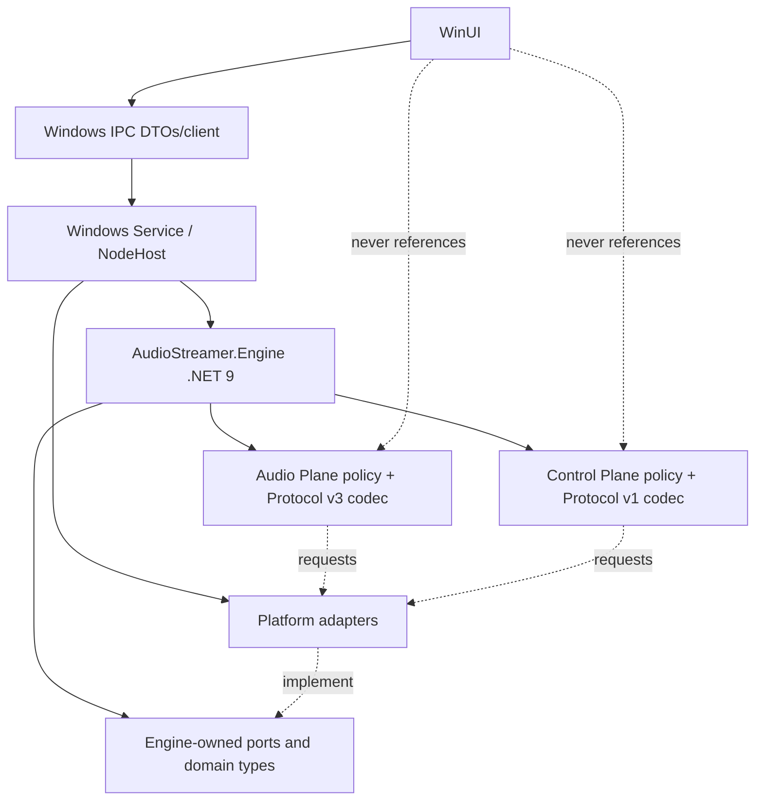

# AudioStreamer Engine Architecture

**Status:** Frozen v2 implementation contract. The Control Plane ownership migration is implemented in source: Engine owns policy/state and Windows adapter owns UDP I/O. Windows build, LAN interoperability, and recovery acceptance testing remain outstanding.
**Normative wire contracts:** [Audio Protocol v3](PROTOCOL.md), [Control Protocol v1](CONTROL_PROTOCOL.md).
**System overview:** [Architecture v2](ARCHITECTURE_V2.md).

## 1. Purpose and scope

The Engine is the reusable .NET node core for Windows and future .NET hosts on Linux/macOS. It coordinates node state, Control Plane policy, Audio Plane workflows, and bounded statistics. It has no user interface, service manager, filesystem path, OS audio API, network socket, IPC transport, or product installer dependency. Android remains a native Kotlin node in v2; ESP32 remains an independent C++ control-only controller.

The Windows v2 implementation target is a C#/.NET 9 Engine class library with typed .NET interfaces. The Windows Service composes and owns one Engine instance. Engine core has no WinUI, SCM, or OS-specific API dependency; Windows-specific WASAPI/network adapters live in a separate assembly. Future Linux/macOS .NET hosts can reuse the Engine. Android remains its native Kotlin implementation in v2 and ESP32 remains a resource-constrained Control Protocol v1 implementation; neither is required to link the Windows Engine.

The repository’s Python and Kotlin implementations are compatibility references during migration. The .NET implementation must match existing normative packet behavior. Porting the Engine does not authorize protocol changes.

## 2. Ownership map

| Owner | Owns | Lifetime |
|---|---|---|
| Windows Service | Process/SCM lifetime, bootstrap configuration/logging, IPC server, process health, and dependency composition | Windows Service process lifetime |
| NodeHost | Engine lifecycle calls and startup/shutdown ordering | Service lifetime; UI connection is not a lifetime input |
| Engine | Node lifecycle, canonical runtime configuration, peer/session state projection, statistics/diagnostics, event bus, use-case command handling through ports | Engine service lifetime; Start/Stop cycles repeat until DI scope disposal |
| Capture adapter | OS capture stream, callback thread, capture-side reusable buffers; only Engine CaptureManager may control it | Sender lane lifetime |
| Playback adapter | OS playback stream and playback worker; only Engine PlaybackManager may control it | Receiver lane lifetime |
| Engine ControlCoordinator | Control v1 discovery, heartbeat/expiry scheduling, peer updates, route policy, command correlation, recovery, and Control state | Engine start/stop cycle; consumes `IControlTransport` and Engine managers |
| WindowsControlTransport | UDP socket, bounded send queue, receive/send loops, network-change subscription, and transport fault reporting | Engine start/stop calls; owns and disposes its socket/workers |
| Audio UDP adapters | Sender socket per active sender lane and receiver socket per active receiver lane | Corresponding lane lifetime |
| Engine DiagnosticsManager | Bounded node/plane counters and sampling timers | Engine lifetime |
| Engine ConfigurationManager | Canonical runtime settings, validation, migration policy, atomic update coordination | Engine lifetime; one writer through injected store |
| ConfigurationStore adapter | OS-specific durable read/write for settings and Node ID | Engine lifetime; invoked only through Engine-owned configuration port |

No component may close a resource owned by another. Owners expose idempotent `stop`/`close`, signal completion, and report failures to their supervisor.

## 3. Subsystems

### 3.1 Node coordinator

Accepts typed commands, validates preconditions, coordinates independent lanes, publishes immutable snapshots and typed events, and reports command acceptance separately from later runtime state. It must not directly open a socket or audio device.

### 3.2 Audio Plane

The Audio Plane is PCM-only. Its portable logic comprises v3 models, serialization/parsing, frame alignment and format validation, sequence tracking, packetization boundaries, queue-duration accounting, and sender/receiver lane policy. Capture/playback APIs and UDP socket operations are adapters.

PCM contract remains stereo IEEE-754 float32 little endian, with the current v3 header and datagram limits. Audio queue capacity is bounded in duration and memory. Capture buffers are pooled or fixed-capacity; no UI/IPC serialization or blocking log calls occur on an audio callback.

### 3.3 Control Plane

The Engine `ControlCoordinator` owns Control v1 protocol policy: HELLO/GOODBYE, heartbeat and peer-expiry scheduling, stream command/status correlation, peer registry updates, route state, and network recovery decisions. It serializes/parses through the authoritative Control Protocol v1 codec and exchanges datagrams using the Engine-defined `IControlTransport`, whose endpoint and event contracts contain no socket or Windows types. `WindowsControlTransport` owns `UdpClient`, socket lifetime, bounded asynchronous send/receive loops, and network-change notifications. The Engine `PeerManager` remains the sole source of peer records. Control policy never sees PCM or accesses audio-device APIs.

Control commands remain best-effort requests. A local send result is not remote acknowledgement. On receipt, the Engine validates the sender/receiver IDs and capabilities, requests lane transitions, then emits existing status/error messages when local state permits.

### 3.4 Platform adapters

Adapters implement Engine-declared capability ports. Adapters report capability availability and typed failures. They do not define node policy or wire layouts. Windows uses WASAPI loopback, a Windows playback adapter, and `WindowsControlTransport`; the Audio v3 UDP transport remains in the audio transport adapter. Future Linux/macOS hosts can provide another `IControlTransport` without moving Control policy out of Engine.

The Control transport port carries an opaque datagram payload, an Engine-owned address/port value, and bounded transport events. `ControlDatagramReceived`, `ControlDatagramSent`, `ControlNetworkAvailabilityChanged`, and `ControlTransportFault` expose no socket objects or platform exceptions. The Engine alone parses/serializes those bytes using Control Protocol v1. Windows Service DI composes `IControlTransport` with `WindowsControlTransport`; future hosts supply another adapter implementation.

### 3.5 Windows Audio Platform adapter and transport foundation

`AudioStreamer.Platform.Windows.Audio` implements Engine-declared capture, playback, device catalog/manager, buffer, clock, conversion, mixing, latency, and diagnostics ports. WASAPI calls, endpoint notification registration, and NAudio types are confined to this Windows-targeted assembly. `AudioStreamer.Audio.Transport` owns the portable v3 codec, frame-aligned packetizer, sequence tracker, bounded receive queue, and async UDP sender/receiver. The Windows session runtime composes these with WASAPI lanes behind an internal Engine port. Transport counters are sampled once per second and projected through the Engine event bridge into `StatisticsManager`; callbacks do not call the event bus. Capture hands off frames through a bounded queue; playback uses a preallocated SPSC ring and the device callback only copies/fills PCM and updates atomic counters. Device enumeration is control-path work.

The v3 codec uses the Python implementation and [PROTOCOL.md](PROTOCOL.md) as its compatibility oracle. Audio receive endpoints and queue bounds load from Service configuration; sender destinations are resolved from the Engine's peer projection. Control v1 serialization has Python-derived wire vectors. Windows hardware behavior, LAN interoperability, and endpoint changes during active streams remain integration verification gates.

## 4. Public Engine and adapter interfaces

The public application boundary is `IEngine`. This API is stable at the domain level and independent of WinUI, SCM, Named Pipe framing, and concrete drivers. The Service host calls it for lifecycle; the Named Pipe dispatcher maps allow-listed UI requests/events to it. UI never references an Engine assembly or internal managers. The public API uses immutable records/collections, `CancellationToken`, and typed `EngineResult<T>` outcomes; expected operational failures are returned, caller cancellation throws `OperationCanceledException`, and unexpected exceptions are contained at the Engine/adapter boundary and reported through diagnostics.

The conceptual contract is:

```csharp
public interface IEngine
{
    Task<EngineResult<EngineStatus>> StartAsync(CancellationToken cancellationToken);
    Task<EngineResult<EngineStatus>> StopAsync(CancellationToken cancellationToken);
    Task<EngineResult<EngineStatus>> RestartAsync(RestartRequest request, CancellationToken cancellationToken);
    Task<EngineResult<EngineStatus>> GetStatusAsync(CancellationToken cancellationToken);
    Task<EngineResult<NodeSnapshot>> GetSnapshotAsync(CancellationToken cancellationToken);
    Task<EngineResult<ImmutableArray<StreamSnapshot>>> GetStreamsAsync(CancellationToken cancellationToken);
    Task<EngineResult<OperationReceipt>> StartStreamingAsync(StreamRequest request, CancellationToken cancellationToken);
    Task<EngineResult<OperationReceipt>> StopStreamingAsync(StreamRequest request, CancellationToken cancellationToken);
    Task<EngineResult<ImmutableArray<PeerSnapshot>>> GetPeersAsync(CancellationToken cancellationToken);
    Task<EngineResult<StatisticsSnapshot>> GetStatisticsAsync(CancellationToken cancellationToken);
    Task<EngineResult<SettingsSnapshot>> GetSettingsAsync(CancellationToken cancellationToken);
    Task<EngineResult<SettingsSnapshot>> UpdateSettingsAsync(SettingsPatch patch, CancellationToken cancellationToken);
    Task<EngineResult<DiagnosticsSnapshot>> GetDiagnosticsAsync(CancellationToken cancellationToken);
    Task<EngineResult<ImmutableArray<AudioDeviceSnapshot>>> GetAudioDevicesAsync(CancellationToken cancellationToken);
    Task<EngineResult<OperationReceipt>> SelectAudioDevicesAsync(AudioDeviceSelection selection, CancellationToken cancellationToken);
    Task<EngineResult<OperationReceipt>> PauseAsync(LaneSelection lanes, CancellationToken cancellationToken);
    Task<EngineResult<OperationReceipt>> ResumeAsync(LaneSelection lanes, CancellationToken cancellationToken);
    Task<EngineResult<EngineStatus>> RestartDiscoveryAsync(CancellationToken cancellationToken);
    EngineVersionInfo GetVersionInfo();
    IAsyncEnumerable<EngineEvent> SubscribeAsync(EventSubscription subscription, CancellationToken cancellationToken);
}
```

These names and semantics are frozen for the v2 API. Implementation may refine internal types without breaking the contract; any public breaking change requires a documented Engine API major version. `GetVersionInfo` is an immutable in-process value and performs no I/O. A stream command reports local acceptance and operation ID, not remote delivery or audible output. `SubscribeAsync` is cancellation-scoped and yields ordered immutable events; reconnecting IPC clients always resynchronize from a snapshot rather than replaying missed Engine events. Cancellation before a mutation is accepted prevents it from starting; after acceptance, Engine owns its completion and reports it by operation ID. For `StopAsync`/`RestartAsync`, caller cancellation may cancel waiting but cannot abandon cleanup or leave resources untracked; the Engine supervisor continues to its bounded deadline.

### API type and method contracts

| API / value | Contract, ownership, and failure behavior |
|---|---|
| `EngineOptions` | Immutable creation-time options: Engine instance ID, policy/capability bounds, event/statistics limits, and shutdown deadlines. It contains no Node ID, settings snapshot, UI state, filesystem paths, sockets, or concrete adapters. NodeHost supplies it once; ConfigurationManager loads Node ID/settings through the injected store during `StartAsync`. |
| `StartAsync` | Transitions `Stopped → Starting → Running` (or `Degraded`); initializes managers and discovery. Idempotent when already running and repeatable after a completed Stop while the Engine scope remains alive. Cancellation requests rollback of partial initialization and awaits owned workers. |
| `StopAsync` | Idempotently transitions to `Stopping → Stopped`, drains lanes, sends best-effort GOODBYE, closes manager-owned runtime resources, and returns a result that identifies any shutdown deadline/resource failure. The same Engine facade may be started again while its DI scope remains alive; scope disposal is terminal. |
| `RestartAsync` | Restarts runtime workers while retaining the Engine facade, Node ID, settings, and subscriptions. Serializes against lifecycle commands; a restart failure returns status/degraded details. It is distinct from SCM process restart and never triggered by UI disconnect. |
| `GetStatusAsync` | Returns lifecycle, discovery/control transport health, lane summary, degraded reasons, and connection semantics. UDP peers are not described as socket-connected; peer freshness comes from Control Plane heartbeat/expiry. |
| `GetSnapshotAsync` | Atomic immutable `NodeSnapshot` with watermark/revision and current service-supplied host health where available. No caller receives mutable registry/state references. |
| `GetPeersAsync` | Bounded immutable `PeerSnapshot` list from the Engine-owned registry, including stable ID, capabilities, source endpoint, freshness, and last-seen age. |
| `GetStreamsAsync` | Immutable local lane/route `StreamSnapshot` list; distinguishes requested, accepted, starting, active, degraded, stopping, and stopped. |
| `StartStreamingAsync` | Validates request and local/peer capabilities, submits existing Control v1 operation or local lane transition as applicable, and returns `OperationReceipt`. No protocol extension or success claim beyond local acceptance. |
| `StopStreamingAsync` | Requests existing stop behavior for the addressed route/lane and returns a correlated receipt. It is an explicit operation, never inferred from UI lifetime or IPC disconnect. |
| `GetSettingsAsync` | Returns the Engine-owned canonical immutable `SettingsSnapshot`, including version/revision and redacted secret presence only. |
| `UpdateSettingsAsync` | Validates a versioned patch, applies atomic persistence through the injected store, publishes `ConfigurationChanged`, and reports field errors/conflict. It cannot accept arbitrary paths or raw protocol bytes. |
| `GetStatisticsAsync` | Returns bounded counters/gauges and sampling time; packet-level updates are aggregated, not emitted as per-packet API events. |
| `GetDiagnosticsAsync` | Returns typed Engine/plane/adapter health and last safe error details; no log scraping or unbounded history. Service process/SCM diagnostics are composed as host health. |
| `GetAudioDevicesAsync` / `SelectAudioDevicesAsync` | Enumerate bounded stable endpoint snapshots and apply validated stable IDs/follow-default selection. Device APIs remain in injected adapters; absent device/unsupported role returns typed capability errors. |
| `PauseAsync` / `ResumeAsync` | Apply documented local lane pause semantics; idempotent and explicit. They never change Control v1 or network peer state. |
| `RestartDiscoveryAsync` | Restart only the Control Plane discovery worker with bounded rate limit; does not recreate node identity or touch audio lanes. |
| `GetVersionInfo` | Returns product-independent Engine API/assembly and supported Audio/Control protocol versions. IPC schema and UI versions remain in IPC negotiation. |
| `SubscribeAsync` | Creates a bounded subscription owned by the async enumerator; cancellation/disposal removes only that subscriber and never changes Engine/manager lifetime. |

### Snapshot model

`EngineStatus` contains lifecycle state, `ControlPlaneStatus`, `AudioPlaneStatus`, lane summary, degraded reasons, and `ConnectionState` for Control UDP binding/discovery health (not a fictitious persistent UDP peer connection); Service-reported process/SCM health is carried as host health. Control state values are `Stopped`, `Starting`, `Discovering`, `Degraded`, and `Faulted`. Peer liveness is represented only by registry freshness/heartbeat expiry. `NodeSnapshot` adds Node ID/name, settings revision, peer/stream summaries, statistics revision, and event watermark. `PeerSnapshot` carries immutable protocol metadata and monotonic-derived age represented as a duration at snapshot time. `StreamSnapshot` contains route/lane IDs, local role, remote Node ID, lifecycle state, negotiated v3 format where applicable, and last transition/error. `StatisticsSnapshot` has bounded counters/gauges with units and sample timestamp. `SettingsSnapshot` has schema version, revision, and validated values. `DiagnosticsSnapshot` is a bounded aggregate of health, capability availability, counters, and safe error references. `EngineVersionInfo` separates Engine API/assembly versions from network protocol versions. IPC connection/reconnection state belongs to the UI/IPC client and is not an Engine node state.

`StreamRequest` identifies an existing route as sender Node ID, receiver Node ID, requested local/remote action, and optional existing Control v1 transaction ID; it cannot carry packet bytes or an arbitrary endpoint. `SettingsPatch` contains expected revision, a finite set of supported setting fields, and no filesystem paths/secrets. `AudioDeviceSelection` uses stable endpoint IDs or an explicit follow-default choice. `RestartRequest` contains a bounded safe reason/correlation ID and the fixed scope `EntireRuntime`; it never carries an executable/path. `EventSubscription` contains a bounded allow-listed event-kind filter and maximum delivery rate; an empty filter means the default public state/event set.

`EngineResult<T>` has exactly one of success, accepted asynchronous operation, or typed failure. `OperationReceipt` carries operation ID and current acceptance state; completion/failure is reported as an event and reflected in later snapshots. Stable error categories include `InvalidState`, `InvalidArgument`, `NotFound`, `CapabilityUnavailable`, `ConfigurationConflict`, `PersistenceFailure`, `TransportUnavailable`, `ResourceBusy`, `ShutdownTimedOut`, and `InternalFailure`. Caller cancellation is represented by .NET cancellation semantics, not an application failure code. Errors include subsystem and stable code, retryability, safe message, and optional field-level details; no raw exception or secret crosses IPC.

Every `EngineEvent` envelope contains Engine instance ID, strictly increasing sequence, component state revision, monotonic observation tick, display-only UTC timestamp, event kind, and a typed immutable payload. Payload bounds and ownership are:

| Event family | Publisher | Immutable payload fields | Explicitly excluded |
|---|---|---|---|
| Lifecycle | StateManager / EngineCoordinator | lifecycle state, revision, safe error code | exceptions, mutable state objects |
| Peer | PeerManager | `PeerSnapshot`, or Node ID/reason/last-seen duration on loss | mutable registry entry |
| Control packet | ControlPlaneManager | message kind, encoded byte count, source endpoint, parse/result code | raw datagram or credentials |
| Audio capture/playback | CaptureManager / PlaybackManager | lane ID, format, frame/packet counters, aggregate interval | PCM, callback memory, per-frame object stream |
| Packet sent/received | owning UDP adapter reports through its Engine manager | plane, packet/byte counters, endpoint, error/drop count | packet payload bytes |
| Stream | StreamingManager / EngineCoordinator | route ID, sender/receiver IDs, operation ID, lane state, safe failure code | mutable route manager state |
| Statistics/diagnostics | StatisticsManager / DiagnosticsManager | bounded snapshot plus sample interval/revision | unbounded history or per-packet event flood |
| Configuration | ConfigurationManager | old/new revision, changed setting keys, apply result | secret values or file paths |
| Warning/error | component owning the failure | stable code, severity, subsystem, safe message, correlation/operation ID | stack trace, raw input, secret |

Required ports:

| Port | Required operations | Constraints |
|---|---|---|
| `AudioCapturePort` | enumerate, open stable endpoint ID, start, stop, report format, deliver frame | Callback cannot block; borrowed memory lifetime is explicit; bounded pool/drop counters |
| `AudioPlaybackPort` | enumerate, open endpoint, write PCM, flush, stop | Backpressure bounded; report underflow/device removal; never run on UI thread |
| `DatagramPort` | bind configured address/port, receive, send, close | Distinct Control and Audio instances; one owner per socket; bounded outbound queue |
| `ClockPort` | monotonic now and cancellable deadline | Wall clock is not used for timeout/expiry decisions |
| `NodeStorePort` | load/store versioned settings and persistent Node ID | One serialized writer; atomic commit; no Engine file paths |
| `DeviceCatalogPort` | stable IDs, friendly names, default/availability changes | Enumeration indexes are presentation-only and never persisted |
| `DiagnosticsPort` | increment counters and publish snapshots | Non-blocking, bounded labels; no PCM/user data |

## 5. Threading and memory model

### 5.1 Threads and workers

- **Engine command coordinator:** one owner serializes node-level commands and state transitions using async operations and bounded channels. It must not perform blocking OS I/O.
- **Control worker:** one worker owns control send/receive ordering and discovery/heartbeat deadlines. The underlying UDP socket itself belongs to the Control UDP adapter.
- **Sender lane:** capture callback is created/owned by the capture adapter; one Engine lane worker packetizes and submits datagrams. The callback writes only bounded frame data to the capture pool.
- **Receiver lane:** one adapter receive worker validates datagram boundaries; Engine packet policy/queueing runs without UI dependencies; one playback worker drains the bounded queue.
- **IPC workers:** belong to the Windows Service IPC layer, not Engine. IPC writes never block Engine workers.
- **Diagnostics sampler:** belongs to Engine DiagnosticsManager and samples at a bounded cadence; Service supplies process/SCM health through its host-health port. No per-packet timer or UI polling timer is allowed.

Use .NET async tasks and bounded `Channel<T>` instances for non-real-time Engine work. The Service creates and owns the Engine instance; Engine managers own their worker tasks and cancellation scopes and are awaited on stop. Platform capture callback threads are owned by their adapters. Thread/task names include subsystem and node instance for diagnostics. No worker depends on UI attachment or subscriber count.

### 5.2 Audio callback rules

The real-time callback may copy into a preallocated bounded pool, update atomic counters, and signal a worker. It may not allocate without a hard bound, lock a contended mutex, wait, perform UDP, serialize IPC, query configuration, or log. If the pool is full, the documented drop policy applies and a counter is incremented. The receiver queue remains bounded by audio duration and maximum bytes.

### 5.3 Cancellation and ownership

Every worker receives a cancellation token owned by its lane/supervisor. Cancellation is idempotent. A worker reports completion before the owner releases its adapter. Shutdown has a deadline and returns an incomplete result if resources do not close; it never fabricates a successful completion.

## 6. Lifecycle state machines

### Node aggregate

```text
Stopped -> Starting -> Idle <-> Active -> Stopping -> Stopped
                    Active/Idle -> Restarting -> Starting
              |          |       |                     ^
              +--------> Faulted  +-> Degraded ----------+
```

`Idle` means Engine initialized and Control Plane may be discovering peers, with no audio lane active. `Active` means one or more audio lanes run. `Degraded` means a required capability is temporarily impaired; snapshots preserve each lane’s state. `Faulted` is reserved for unrecoverable initialization or internal invariant failures.

### Sender and receiver lanes

```text
Stopped -> Starting -> Running -> Stopping -> Stopped
              |          |
              +-> Failed +-> Degraded -> Recovering -> Starting
```

Sender owns capture and audio send resources. Receiver owns audio receive, bounded packet queue, and playback. They transition independently and may run simultaneously.

### Discovery and peer registry

Discovery: `Disabled → Starting → Discovering ↔ Degraded → Stopping → Disabled`.

Peer record lifecycle: `Unknown → Announced → Refreshed* → Expired | Goodbye`. The Engine `PeerManager` is the sole bounded registry, including Control v1 IDs, Engine IDs, capabilities, status, audio/control endpoints, protocol version, and monotonic last-seen time. The Engine `ControlCoordinator` supplies network observations through an Engine-internal peer port; it does not maintain a second peer map. Expiry removes the record and publishes updated Engine state. IPC and routing query the Engine registry through the public Engine API; no caller receives a mutable map.

### Stream command lifecycle

`Received → Validating → Accepted → StartingLane → Running | Failed`. Stop: `Received → Validating → StoppingLane → Stopped | Failed`. A transaction ID, if present in existing v1, is preserved in responses. No new transaction field is introduced. A command addressed to another node is ignored/rejected according to existing v1 behavior and logged at a rate-limited level.

## 7. Dependency graph



The dotted arrows are runtime calls through injected ports. The Engine has no dependency on adapters; adapters implement its contracts. Audio and Control Plane share node identity/state contracts only. They do not import each other’s packet types.

## 8. Startup and shutdown sequences

### Startup

1. Windows Service registers its SCM handler and obtains only the bootstrap settings/paths needed for config migration and Node ID preservation; failures use Event Log fallback.
2. Service initializes structured logging and process health supervision using validated safe bootstrap settings.
3. Windows Service builds dependency injection, including its platform ConfigurationStore adapter and immutable EngineOptions.
4. NodeHost creates the Engine scope; Engine ConfigurationManager loads/validates canonical runtime settings, then Engine starts managers and discovery.
5. Engine publishes `Running/Idle` or a truthful degraded snapshot. Audio lanes remain stopped until a route is requested.
6. Windows Service opens IPC after Engine readiness. UI obtains a snapshot, then subscribes to events. Engine/discovery start whether or not UI connects.

### Shutdown

1. Service rejects new IPC mutations, publishes `ServiceStopping`, and signals NodeHost; SCM callback returns promptly.
2. NodeHost invokes `IEngine.StopAsync`; coordinator rejects new runtime commands and stops sender/receiver workers independently.
3. Engine managers flush/close playback and audio UDP, attempt GOODBYE, stop heartbeat/discovery, and await all workers up to the configured deadline.
4. Engine publishes final state/diagnostics, completes its event bus, then the host closes IPC and disposes Engine DI scope/adapters.
5. Service disposes NodeHost and process-health resources, then logging and bootstrap configuration in reverse construction order; report SCM `Stopped` only after completion or explicit timeout handling.

### Streaming

1. Local UI request becomes a typed IPC command; remote Control v1 command becomes a typed Engine command. Both use the same validation/use case.
2. Control Plane validates identity, peer presence/capabilities, and command fields. It does not start audio itself; it requests the node coordinator to transition the appropriate lane.
3. Sender starts capture, confirms PCM format, packetizes v3 frames, and sends through its Audio UDP adapter. Receiver binds audio UDP, validates v3, tracks sequence/stream ID, feeds bounded queue, and plays through adapter.
4. Engine publishes state and bounded stats. Control Plane sends existing STREAM_STATUS/ERROR where required. IPC pushes local snapshots/events without PCM.

## 9. Error and recovery policy

Errors are typed by subsystem and severity: recoverable device/network loss, invalid user command/configuration, incompatible protocol input, and fatal invariant/startup failure. Recoverable adapter errors transition only the affected subsystem/lane and use bounded retry with backoff. Invalid network packets are dropped and counted; malformed local IPC is rejected and may close the offending connection. No remote packet can crash the Engine.

Recovery must not create duplicate workers/sockets. The owner first confirms the previous resource closed, then creates a replacement. Node ID and settings survive restart; transient peer registry and active streams do not. On Engine/service restart, state returns to idle/discovering; automatic stream restoration is not assumed because Control Protocol v1 has no durable session negotiation.

## 10. Extensibility and invariants

- New .NET platforms implement ports and a NodeHost; they do not fork Engine policy. Android retains its Kotlin implementation and the same normative wire behavior.
- New capability types require explicit node capability-model evolution; they are not inferred from a platform string.
- New network fields/messages require protocol-document updates and coordinated Python, Kotlin, .NET, and ESP32 implementation changes as applicable.
- A Control Plane command may request a lane change but cannot access PCM or buffers.
- A platform adapter may convert native sample representations only at a clearly bounded edge; emitted/accepted wire PCM stays v3-compliant.
- All queues, registries, event histories, IPC clients, retries, and logs have explicit bounds.
- All clocks used for expiry and deadlines are monotonic.

## 11. Internal event system

All subsystem notifications use one Engine-instance `IEngineEventBus`. Managers depend on the publisher/subscriber interfaces, never on peer managers directly. Request/response commands continue through `IEngine` use cases and typed manager ports; the event bus is not a hidden RPC mechanism and must not be used to make critical commands whose result must be awaited.

| Concern | Frozen contract |
|---|---|
| Publisher | The manager that owns the transition publishes the immutable domain event after committing its state transition. Event bus adds Engine instance ID, monotonic sequence, UTC observation time for display, and source subsystem. |
| Subscribers | Engine state projection, dependent orchestration handlers, Statistics/Diagnostics managers, and external API subscriptions. Service IPC is an external subscriber to the public Engine event stream; UI is never an in-process subscriber. |
| Thread ownership | Publish is non-blocking and never invokes subscriber code inline. Each internal subscriber has one async reader and an explicitly bounded channel. Audio callback threads do not publish object-rich events. |
| Ordering | Sequence is monotonically increasing per Engine instance. Per-subscriber delivery preserves publish order. Concurrent sources are serialized at the bus ingress; no stronger causal ordering across independent workers is promised. State-changing events include state revision so consumers can reject stale updates. |
| Delivery | In-memory, at-most-once, best-effort while Engine is alive. Events are not durable and do not cross Engine restart. Consumers recover from gaps/restart by querying a fresh snapshot. |
| Failure | Subscriber exceptions are isolated, counted, and reported to Diagnostics; they never fail the publisher or other subscribers. Repeated failure disables the affected subscriber and surfaces degraded health. |
| Backpressure | Channels have fixed capacity. Replaceable statistics/diagnostic updates coalesce by key. Lifecycle, peer, configuration, and error events use reserved capacity; if critical capacity is exhausted, bus marks `ResyncRequired`, drops the subscriber, and requires snapshot recovery. Publishers never wait for a slow subscriber. |
| Memory | Payloads are immutable value/record data with bounded strings/collections. Events never expose mutable maps, socket buffers, `Memory<T>` backed by reused audio buffers, or PCM. Audio frame/packet events contain metadata/counters only and are aggregated at a fixed cadence. |
| Lifetime | Bus belongs to the Engine instance and completes channels after manager shutdown. Each subscription is disposable/cancellation-scoped. Removing a subscriber cannot stop a manager or Engine. |

Canonical event families: `EngineStarted`, `EngineStopping`, `EngineStopped`, `EngineRestarted`, `PeerDiscovered`, `PeerUpdated`, `PeerLost`, `ControlPacketReceived` (type/size/endpoint metadata only), `AudioCaptured` (aggregated frame/sample counters only), `PacketSent`, `PacketReceived` (protocol, byte/count metadata only), `PlaybackStarted`, `PlaybackStopped`, `StatisticsUpdated`, `ConfigurationChanged`, `StreamingStarted`, `StreamingStopped`, `WarningRaised`, `ErrorRaised`, `DiagnosticsChanged`, and `ResyncRequired`. High-frequency events are aggregated/coalesced; none contains raw PCM or packet payload bytes.

## 12. Dependency injection and service lifetimes

The Windows Service is the composition root. It creates the .NET Generic Host, loads bootstrap configuration, establishes logging, registers adapters/managers, builds one root provider, and starts the Engine lifecycle supervisor followed by the IPC host. The Engine is a singleton per NodeHost/Engine instance; it is not a process-global static. No component resolves dependencies from `IServiceProvider` at runtime except declared factories/scope factories.

| Lifetime | Registrations and ownership |
|---|---|
| Singleton per Engine | `IEngine`, `EngineCoordinator`, `IEngineEventBus`, Audio/Control/Discovery/Peer/Statistics/Diagnostics/Configuration/Health managers, protocol codecs (stateless), monotonic clock, immutable options, and persistent store adapter. All singleton managers are constructed through DI. |
| Singleton per Service process | SCM adapter/supervisor, NodeHost, IPC listener, IPC authorization/version policy, structured logger provider, process-health collector, service configuration bootstrap, update-status bridge. The Engine DI scope is owned by NodeHost so Engine restart/disposal can be supervised without restarting IPC. |
| Scoped per IPC request | Request correlation/authorization context, DTO validator/mapper, and command dispatch context. Scope ends after response/operation acceptance; long-running operations transfer ownership to Engine managers and use Engine-owned cancellation. |
| Transient/factory-created | Capture/playback session objects and lane-scoped UDP transports when each lane starts. Factories own validation and construction; managers dispose instances after worker completion. Never register a live device/socket as transient and inject it into unrelated consumers. |
| Hosted services | `EngineLifecycleHostedService` supervises initial start/stop and process recovery; `IpcHostedService` starts after Engine readiness and retries listener-only faults; process health/log maintenance workers are hosted and do not control Engine based on UI liveness. |
| Update process | Signed installer/updater is a separate elevated process, not an Engine DI service. The Service can expose update state through an injected, narrow status provider and can participate in a planned drain requested by the installer. |

Dependency rule: Engine contracts and orchestration depend inward on abstractions; Windows drivers implement Engine ports; NodeHost composes Engine with those drivers; IPC maps JSON to `IEngine`; UI references only IPC DTO/client contracts. Service infrastructure may call `IEngine` lifecycle/query methods, but must not call internal managers. Platform drivers never reference IPC, WinUI, or other platform adapters. No circular project reference is permitted.

## 13. Manager responsibilities and dependency boundaries

All managers are Engine-owned singleton collaborators, except lane/session workers created by explicit factories. Each manager exposes a narrow interface, publishes immutable events, and has an explicit cancellation owner. Managers never reference sibling manager implementations or interfaces. EngineCoordinator is the sole application orchestration layer: it dispatches typed commands through manager-neutral command ports and observes event-bus notifications to coordinate workflows.

| Manager | Responsibilities / public internal API | Dependencies and events | Lifetime/thread |
|---|---|---|---|
| `StateManager` / `EngineCoordinator` | Serialize lifecycle and commands; own state revisions; validate transitions; compose `NodeSnapshot`; route remote/local requests | Public API command channel, manager-neutral command-router ports, event bus; emits lifecycle/operation events | Engine lifetime; single-reader bounded command channel |
| `AudioManager` | Coordinate independent sender/receiver lanes and route policy; never capture PCM itself | Invoked only through EngineCoordinator command routing; capture/playback/transport ports; emits lane transitions | Engine lifetime; no blocking I/O |
| `CaptureManager` | Create/stop capture sessions, select endpoint, normalize callback frame ownership/format, count capture drops | `IAudioCaptureFactory`, buffer pool; emits aggregated capture/device events | Manager Engine lifetime; capture session per sender lane; callback owns no engine state |
| `PlaybackManager` | Create/stop playback sessions, bounded queue handoff, device/underflow state | `IAudioPlaybackFactory`; emits playback/device events | Manager Engine lifetime; playback session per receiver lane |
| `StreamingManager` | Coordinate stream request/operation IDs, route state and sender/receiver workflows | Invoked through EngineCoordinator; emits StreamingStarted/Stopped/failed | Engine lifetime; no direct sibling-manager reference |
| Engine `ControlCoordinator` | Control v1 discovery/heartbeat/GOODBYE, expiry, route policy, command/status correlation, recovery, peer projection requests | `IControlTransport`, Engine peer/session managers, Engine event bus | Engine runtime cycle; bounded channels and individually supervised workers |
| Windows `WindowsControlTransport` | UDP socket, send/receive loops, network-change notifications, transport faults | `IControlTransport`; no Control policy or protocol codec | Engine runtime cycle; bounded channels and awaited workers |
| Engine `PeerManager` | Bounded immutable projection of discovered peer identity/name/audio endpoint and freshness | Engine ControlCoordinator and event bus | Engine lifetime; serialized mutations |
| `StatisticsManager` | Aggregate bounded counters/gauges, sample intervals, calculate queue duration/drop rates | Event bus and atomic instrumentation handles; emits coalesced StatisticsUpdated | Engine lifetime; fixed cadence, atomic increments on hot paths |
| `DiagnosticsManager` | Project Engine/plane/driver health and typed last errors; combine host-health input | Event bus, statistics projection, host-health port; emits bounded diagnostics change | Engine lifetime; fixed cadence and snapshot queries |
| `ConfigurationManager` | Own canonical settings revision, validate patches, migration rules, atomic commit orchestration | `IConfigurationStore`, immutable EngineOptions, event bus; emits ConfigurationChanged | Engine lifetime; one serialized writer, snapshots read concurrently |
| `HealthManager` | Derive Engine health/degraded reasons from published component status without taking their resources | Event bus and host-health port; emits health state change | Engine lifetime; serialized projection |
| `LoggingManager` | Engine-side logging facade/context and redaction policy; no file sink or callback logging | `ILogger` abstraction supplied by host; emits no domain event for every log record | Engine lifetime; logging calls on non-real-time workers only |
| `UpdateManager` | Not an Engine manager: updater verifies/stages signed product and controls install/rollback | Separate elevated installer process; narrow Service drain/version/status boundary | Installer/update process lifetime; Engine cannot self-update |

`ControlPacketReceived`, `PacketSent`, `PacketReceived`, and `AudioCaptured` are diagnostics/event projections, not a mechanism to ship full data between managers. Streaming commands use typed coordinator calls so acceptance, cancellation, and error results remain correlated and awaitable.

### Milestone 4 implementation checkpoint

The audio session path now resolves remote audio endpoints from the Engine-owned peer registry, negotiates Control v1 START/STOP before starting a local sender, starts a receiving lane before accepting a remote sender, and compensates local resources on negotiation failure. Sessions publish explicit negotiating, preparing, streaming, paused, recovering, stopping, stopped, and failed transitions. On peer expiry, active lanes are released and marked recovering; rediscovery retries retained routes through Control negotiation. Audio v3 transport uses one receiver socket per local bind endpoint, routes by source IP (the current v3 packet has no route identifier), and maintains bounded per-peer reorder/playout queues with duplicate, late, missing, recovered, overflow, jitter, and underrun counters. IPC exposes session transitions, stream snapshots, statistics, diagnostics, audio events, and pause/resume operations. Automated queue ordering and routed-receiver tests were added. Build/test execution and Windows-to-Windows LAN, network interruption, restart, long-duration, and audible switching behavior remain unverified because the .NET SDK and test hardware are unavailable in this environment. Average/peak end-to-end latency, clock drift, and per-session capture/playback rates are not currently measured; do not present them as implemented diagnostics.

## 14. Frozen composition and lifecycle sequences

### Startup

1. SCM starts the Windows Service process and reports `StartPending` checkpoints.
2. Service bootstrap reads only the bounded bootstrap configuration needed to locate/migrate machine storage and establish the stable Node ID. If bootstrap loading fails, report through Windows Event Log fallback and fail startup without opening network/audio resources.
3. Logging bootstrap creates the structured logger from safe bootstrap settings. Service process diagnostics and failure handling become available.
4. Service builds the DI graph with immutable `EngineOptions`, Windows adapters/factories, Engine managers, Engine event bus, NodeHost, and IPC services. ConfigurationManager loads/validates the canonical versioned settings snapshot through `IConfigurationStore` before Engine workers start.
5. NodeHost resolves the Engine scope and calls `IEngine.StartAsync`. Engine starts node managers, starts the injected Control transport adapter, then starts discovery/heartbeat policy workers and advertises HELLO. No UI is required.
6. Only after Engine reaches a queryable ready/degraded state does the Service start the Named Pipe IPC host and version negotiation. Service reports SCM `Running` when supervision is established; an IPC listener failure is independently retried and does not stop Engine.
7. A UI client connects, negotiates IPC versions, obtains an authoritative `IEngine` snapshot, and subscribes. It does not construct managers or start runtime work.

### Shutdown and restart

On real SCM stop or installer-coordinated update, Service rejects new mutations, marks IPC as stopping, and signals NodeHost. NodeHost calls `IEngine.StopAsync`; Engine quiesces Control commands, sends best-effort GOODBYE, stops the Control transport and policy workers, then stops audio/session managers. Event subscriptions and the Engine scope are disposed after cleanup. IPC is closed, NodeHost is disposed, and logger/config bootstrap resources are disposed last. SCM callbacks only signal the async supervisor and return promptly.

`IEngine.RestartAsync` is an explicit runtime operation: coordinator serializes it, transitions through `Restarting`, drains manager-owned workers, recreates runtime sessions while preserving Engine facade/config/Node ID/subscribers, restarts discovery, and returns the new snapshot. It is never called on UI disconnect, pipe heartbeat loss, or client-count change. `StopAsync` stops a runtime cycle; the facade can be started again until its Engine DI scope is disposed. Process recovery creates a new instance.

### Streaming

UI request → Named Pipe validation/authorization → `IEngine.StartStreamingAsync` → EngineCoordinator/StreamingManager validation → ControlPlaneManager sends existing Control v1 request and/or local lane transition → AudioManager starts a bounded sender/receiver session → capture/UDP/packet/playback drivers. State/operation events return over `IEngine.SubscribeAsync` and IPC. Control v1 remains best-effort; a local acceptance is distinct from peer response and audible playback. Stop follows the same path and never runs implicitly on UI lifecycle.

