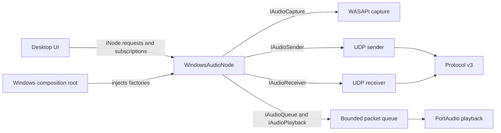

# AudioStreamer Node Framework

## Purpose

The node framework provides a platform-neutral lifecycle and status surface around the existing Audio Plane. A node is a capability-bearing process; sender and receiver capabilities have independent lifecycles and may run at the same time. The framework does not change protocol v3, packetization, capture behavior, buffering policy, or playback behavior.

## Responsibilities

`core/node/` defines the Windows-side `INode`, immutable settings and identity values, capability flags, typed events, snapshots, and permitted lifecycle transitions. Android mirrors this contract with Kotlin `INode`, `NodeSettings`, `NodeSnapshot`, and independent lane states under `platforms/android/.../core/node/`, because the Python package cannot be linked into a native Kotlin application.

`core/audio/interfaces.py` defines structural contracts for capture, sender, receiver, queue, and playback implementations. These contracts carry existing PCM and packet types; they do not own implementations or change their behavior.

`platforms/windows/desktop/bootstrap.py` is the Windows composition root. It injects WASAPI capture, the existing v3 UDP sender/receiver, the existing bounded packet queue, and PortAudio playback into `WindowsAudioNode`. The node owns the created engines for each active lane and releases them when workers end.

`platforms/windows/desktop/node.py` implements `INode`, coordinates independent workers, maps engine status into node states, and publishes events. It does not define packet layouts or transport serialization.

`platforms/windows/desktop/gui.py` accepts only `INode`. It sends settings and lifecycle requests through the contract and subscribes to immutable events. Event callbacks run on worker threads and only enqueue data; Tk drains that queue on its event loop before touching widgets. The short Tk timer drains queued events only; it does not poll sockets, threads, or node internals.

## Dependency shape

The Control Plane has its own versioned binary protocol, registry, and UDP manager. It exposes discovered node records and typed START_STREAM/STOP_STREAM commands to platform nodes. It remains outside the Audio Plane and has no access to PCM payloads through this interface.

## Lifecycle model

Sender and receiver each have `STOPPED`, `STARTING`, `RUNNING`, `STOPPING`, and `ERROR` states. A node snapshot reports both lane states and an aggregate status. A healthy running lane keeps aggregate status `RUNNING` while the other lane starts or stops; a lane error makes the aggregate `ERROR` while preserving the other lane's independent state.

Node listeners receive typed events for state changes, format and statistics updates, errors, and completed shutdown. Listeners must be quick and thread-safe. A UI listener should marshal events to its UI thread instead of mutating UI controls from a worker callback.

`shutdown()` requests both lanes to stop; it does not block the caller. `SHUTDOWN_COMPLETE` is published after sender, receiver, and playback workers have returned and released their resources. A lane can be stopped or restarted without stopping the other lane.

## Extension guidance

- Implement `INode` for another platform; keep its device APIs in `platforms/<platform>/`.
- Inject components through a platform composition root, not through GUI or protocol modules.
- Keep Audio Plane component interfaces focused on operation and lifecycle. Do not add UI state or discovery to them.
- Keep settings platform-neutral at the node boundary; map platform-only details inside the implementation.
- Do not interpret a UDP send count as delivery confirmation. The current protocol has no acknowledgements.

## Current limits

Windows and Android implement equivalent platform-native audio-node contracts and Control Protocol v1 discovery/command handling. Both platforms use stable random nonzero 64-bit node IDs, configurable UDP control port 55050 by default, periodic HELLO/HEARTBEAT, registry expiration, and immediate GOODBYE handling. The ESP32 is a control-only hardware client, not an audio node; it maintains its own peer view and issues existing start/stop requests. Android Control Plane socket creation, bind, send, receive, broadcast, and cleanup run through a background IO coroutine. The PCM sender copies callback-owned data into a bounded channel and a single IO worker performs UDP sends. Capture permission prompts and UI state remain on the main thread. Physical-device control-plane behavior still requires runtime validation.

## Android node

`AndroidNode` implements the equivalent Kotlin node contract and owns settings, state, sender, receiver, `AudioPlayer`, and lifecycle coordination. `MainActivity` observes the node's `StateFlow` and issues node operations; it does not own sockets, queues, capture jobs, or playback engines. Android settings are saved in app-private `SharedPreferences`.

`AndroidPlaybackCapture` is the platform capture adapter. It requests `RECORD_AUDIO` and the system MediaProjection consent, then starts `PlaybackCaptureService` as a media-projection foreground service. The service captures 48 kHz stereo float PCM into fixed reusable buffers, excludes AudioStreamer’s own UID to prevent receive-to-send feedback, and invokes the node's synchronous PCM callback. The Android v3 sender reuses a datagram buffer and the Kotlin serializer that mirrors the frozen root `PROTOCOL.md` layout. The Kotlin receiver, parser, bounded queue, and AudioTrack player remain the existing receive path.

Android playback capture exists from Android 10 (API 29). It captures only eligible `USAGE_MEDIA`, `USAGE_GAME`, or `USAGE_UNKNOWN` playback from apps whose capture policy permits it, with user-approved MediaProjection. Audio from protected or opted-out apps cannot be captured. The app requests `RECORD_AUDIO`; it does not use the microphone as an audio source. Android 14/API 34+ requires the media-projection foreground-service declaration and permission. Because the app targets API 37, local UDP send and receive also require the `ACCESS_LOCAL_NETWORK` runtime permission. The receive/playback-only path can run on older supported Android versions; mixed playback sending reports unsupported below API 29.

Android end-to-end transport and physical audio quality require Android devices. A successful Gradle build or serializer inspection does not prove Android-to-Windows, Android-to-Android, or acoustic playback behavior.

## Control Plane

The ESP32 controller is intentionally not an `INode` audio implementation: it has no capture, send-audio, receive-audio, or playback capability. It is a hardware Control Plane client that discovers nodes, maintains its peer view, and issues existing v1 stream commands from its event-driven OLED/joystick UI. Its Control UDP socket and peer maintenance run on a background FreeRTOS task. The module and hardware map is documented in `esp32_controller/README.md`.

Python `control_plane/protocol/` owns the v1 packet model, serializer, parser, and wire constants. On Windows, `broker.py` is the single owner of the configured UDP socket and relays datagrams over an authenticated named pipe; `transport.py` is the local message-bus client. Every local manager retains its own identity, registry, and dispatch policy, while only the broker binds the network port. `manager.py` applies discovery/heartbeat/command policy; `registry.py` stores peer snapshots and expiry. The Windows composition root attaches the manager to `WindowsAudioNode`; node events publish registry snapshots to the GUI.

Android mirrors the v1 wire format in its native Kotlin Control Plane package and owns its registry/UDP manager inside `AndroidNode`. `MainActivity` observes node state and invokes typed stream requests; it does not handle control sockets or packet encoding. Android requests runtime local-network permission on API 37+ before starting discovery. The Kotlin implementation mirrors the wire contract rather than importing Python source.

The six-byte control header is magic `AC`, version, type, and big-endian payload length. Control v1 uses a dedicated port, status/capability enums, UTF-8 name/platform fields, and optional trailing transaction IDs. See [CONTROL_PROTOCOL.md](../CONTROL_PROTOCOL.md) for normative offsets, values, validation, discovery, and extension rules. Control commands are requests, not delivery acknowledgements; Audio Protocol v3 and its packet layout remain unchanged.
