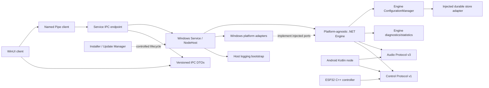

# AudioStreamer v2 Repository Structure

**Status:** Frozen target layout. The current repository remains the v1 Python/Kotlin/C++ implementation until replacement parity and installed v2 validation pass.

The .NET slices now include Engine, Windows configuration/audio adapters, Audio v3 transport, Service, IPC DTOs/transport, a development console client, and the Milestone 5 WinUI client, UI Core, and UI-core tests. The UI references IPC only. Current capabilities and known phase limits are documented in [V2_FOUNDATION.md](V2_FOUNDATION.md); installer and updater remain deferred.

## 1. Target tree

```text
audio_plane/                              v1 Python Audio Protocol reference during migration
control_plane/                            v1 Python Control Plane reference during migration
control_client/                           v1 Windows Device Manager during migration
core/                                     v1 Python contracts; not the v2 Engine
src/
  AudioStreamer.Engine/                   platform-agnostic .NET 9 node/application logic
  AudioStreamer.Audio.Transport/          portable Audio v3 codec, packetizer, bounded queue, UDP transport
  AudioStreamer.IPC.Contracts/            versioned Named Pipe IPC DTOs; no Engine types
  AudioStreamer.IPC/                      Named Pipe transport/client, framing and dispatch ports
  AudioStreamer.Common/                   small cross-cutting primitives only; no domain policy
  AudioStreamer.Platform.Windows/         Windows configuration and shared platform adapters
  AudioStreamer.Platform.Windows.Audio/   WASAPI capture/playback, PCM utilities, device catalog/notifications
  AudioStreamer.Service/                  SCM host, NodeHost composition, authoritative runtime
  AudioStreamer.UI.Core/                  platform UI state/view models, IPC-only coordinator, navigation contracts
  AudioStreamer.UI/                       WinUI 3 presentation, tray integration, per-user presentation preferences
installer/                                signed install, repair, upgrade, rollback packaging
tests/
  AudioStreamer.Engine.Tests/             Engine state, policy, and lifecycle tests
  AudioStreamer.Audio.Transport.Tests/    Audio v3 fixtures, parser, queue, sequence, and UDP tests
  AudioStreamer.Service.Tests/            service composition and recovery tests
  AudioStreamer.IPC.Tests/                framing, schema, ACL, reconnect, compatibility tests
  AudioStreamer.UI.Tests/                 UI Core navigation contract tests
  AudioStreamer.ProtocolFixtures/         canonical Audio v3 and Control v1 byte fixtures
tools/                                    development/release tooling; no runtime ownership
  AudioStreamer.ConsoleClient/            development-only Named Pipe client
  AudioStreamer.ProtocolCompat/           CLI used by Python/.NET Audio v3 exchange tests
platforms/android/                         native Kotlin node and platform adapters
esp32_controller/                          C++ control-only hardware controller
config/migrations/                         versioned migration fixtures; never user data
docs/                                      architecture, protocol, operations, test specifications
```

Generated outputs (`bin/`, `obj/`, `.gradle/`, `.pio/`, logs, installers, packages, dumps, local settings, secrets, and audio captures) are excluded from source control.

## 2. Folder ownership

| Folder | Owner and permitted content |
|---|---|
| `src/AudioStreamer.Engine/` | Engine owner; platform-agnostic node lifecycle/policy, plane orchestration, configuration/diagnostics/statistics managers, internal event bus, and stable `IEngine` API. No SCM, WinUI, IPC framing, or concrete OS APIs. |
| `src/AudioStreamer.Audio.Transport/` | Portable Audio Plane owner; v3 codec, packetization, bounded receive queue, sequence tracking, and UDP send/receive. |
| `src/AudioStreamer.IPC.Contracts/` | IPC owners; versioned immutable Named Pipe DTOs only. Engine domain/API types stay in the Engine assembly; Audio/Control wire definitions remain in their protocol-owning implementations/docs. |
| `src/AudioStreamer.IPC/` | IPC transport owner; framing, ACL-protected pipe server/client, sessions, request dispatcher, correlation, and bounded event fan-out. It references IPC.Contracts and has no Engine dependency. |
| `src/AudioStreamer.Common/` | Build/runtime owners; narrowly scoped primitives with no domain ownership. Do not place Engine policy or platform-specific helpers here. |
| `src/AudioStreamer.Platform.Windows/` | Windows platform owner; durable configuration-store adapter and Windows Control UDP transport adapter implementing Engine ports. |
| `src/AudioStreamer.Platform.Windows.Audio/` | Windows audio owner; WASAPI shared-mode capture/playback, endpoint notifications/catalog, reusable PCM buffers, format conversion/mixing, clock, latency, and audio diagnostics. No Control Plane or UDP ownership. |
| `src/AudioStreamer.Service/` | Service owner; SCM integration, NodeHost lifetime, Engine and adapter composition, bootstrap configuration/logging, process health, IPC server composition, and the narrow Engine-to-IPC DTO adapter. It never bypasses Engine managers to mutate runtime state or owns a separate Control runtime. |
| `src/AudioStreamer.UI/` | UI owner; WinUI views/view models, user-only presentation preferences, Named Pipe client. No direct Engine assembly, audio, discovery, registry, or Control UDP ownership. |
| `installer/` | Release engineering; signed install, service registration, upgrade/repair/uninstall, rollback, and prerequisite detection. |
| `tests/AudioStreamer.ProtocolFixtures/` | Protocol owners; canonical positive/negative Audio v3 and Control v1 fixtures shared by language/platform tests. |
| `platforms/android/` | Android owner; native Kotlin node, lifecycle and OS adapters. It preserves wire compatibility and does not depend on the Windows .NET Engine. |
| `esp32_controller/` | Firmware owner; fixed-capacity C++ Control v1 controller and hardware UI; no audio processing. |
| `config/migrations/` | Configuration owner; versioned schema migration fixtures only, never live user configuration. |
| `docs/` | Architecture, protocol, release, and platform owners; normative contracts and implementation specifications. |

## 3. Dependency direction



The Engine depends only on platform-neutral contracts and BCL-level primitives. Hosts compose it with ports implemented by platform adapters. The Service owns the Windows Engine instance and is the machine-level authority. UI depends on IPC contracts only; UI process lifetime cannot own runtime resources. Android and ESP32 remain independent implementations governed by the normative protocol specifications and shared fixtures.

## 4. Migration ownership and cleanup

Keep existing v1 paths until replacement parity and installed v2 validation pass. Mark their role as compatibility/reference in documentation before moving files. Do not rename/delete active paths during the same change that introduces v2, and do not run old and new Windows node hosts simultaneously. Remove legacy launchers/brokers only in a separately reviewed cleanup after migration and rollback windows expire.

Every new source folder requires an owning component and documented dependency edge. No generic `common/`, `shared/`, or `utils/` folder may become a dumping ground; types belong to the subsystem that owns their invariants.

`src/AudioStreamer.Control.Protocol/` owns the .NET Control Protocol v1 wire codec only. It has no socket, Engine, audio, or Service dependencies. The Engine references this codec and owns Control policy; `AudioStreamer.Platform.Windows` references Engine and implements its `IControlTransport` port. The Service composes both without creating a project cycle.
